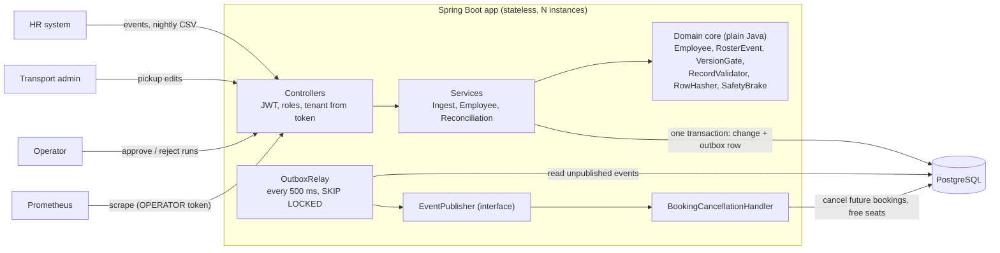
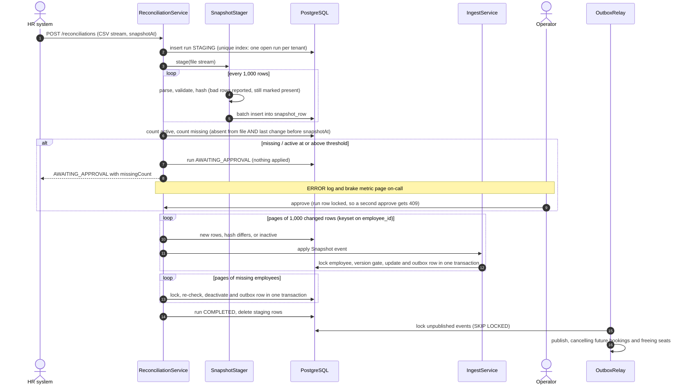

# Design note: HR Roster Sync

## Architecture

A **modular monolith**: one stateless Spring Boot app (run as many instances as needed) in front of one PostgreSQL. The
database is the referee for ordering, idempotency and locking, so correctness never depends on which instance handles a
request.

**Layers:** controller (HTTP and roles only) → service (transactions, orchestration) → repository (SQL), with the business
rules in `core/` and the `Employee` aggregate. These are plain classes, unit-tested without Spring or a database.

**OOP:** *encapsulation* (`Employee` has no setters, so state changes only via `applyHr` / `deactivate` / `updateTransport`,
which enforce the rules). *Inheritance* (`BaseTenantEntity` gives every entity a tenant and timestamps). *Polymorphism*
(the sealed `RosterEvent` with `Create`/`Update`/`Deactivate`/`Snapshot`, each knowing how to apply itself; the `FieldRule`
validators; the `EventPublisher` implementations).

## Data model (the columns that carry the guarantees)

| Table | Key columns | Guarantee |
|---|---|---|
| `employee` | `UNIQUE(tenant_id, employee_id)`, `hr_version`, `row_hash`, `last_hr_change_at`, HR fields, transport fields, `opt_lock` | `hr_version` is the idempotency/ordering state. `row_hash` makes the nightly diff one comparison. Transport fields are written only by transport edits |
| `outbox_event` | `event_id` (UUID), `payload` (IDs only), `published_at`, `attempts`; partial index on unpublished rows | Written in the same transaction as the change. The relay finds work cheaply, and poison events are parked after 10 attempts |
| `reconciliation_run` | `status`, `snapshot_at`, `threshold`, counts, `decided_by`; partial unique index (one open run per tenant) | Durable brake decision and audit trail. A held run survives restarts |
| `snapshot_row` | `PK(run_id, employee_id)`, `row_hash`, `valid` | The file lives here, not in memory. Rejected rows still count as "present". Deleted when the run ends |
| `reconciliation_rejection` | `PK(run_id, row_number)`, `employee_id` (safe IDs only), `errors` (codes) | The complete per-row error report, written in batches of 1,000 and kept after the run so HR can fix every row. Never holds field values |
| `booking`, `trip` | `status`; `seats_booked CHECK (0..capacity)` | Side effects of deactivation. A seat count can never go negative |

Every table has `tenant_id`, and every query filters by the tenant from the verified JWT.

## Hardest flow: nightly reconciliation with the safety brake

Why it's safe: the file is never in memory (stream → batches → set-based SQL → pages). A file row can't revert a newer
real-time change (same version gate as the API). A truncated file can't deactivate anyone without a human. People who joined
after the export are excluded. Every step is idempotent, so a crashed run can simply be re-uploaded.

## Failure modes

| What fails | What the user sees | How the system recovers |
|---|---|---|
| Database down mid-batch | **503 `DATABASE_UNAVAILABLE`** at once (no per-record slow failures); earlier records stay committed | Client retries the whole batch: already-applied records come back `duplicate`, so retrying is safe |
| Another transaction holds an employee's row lock too long | That record: `LOCK_TIMEOUT` (retryable); the rest of the batch is applied | `lock_timeout` 5 s bounds the wait; resend the batch |
| One record hits an unexpected DB error | That record: `PROCESSING_FAILED`; the batch continues | Fix the cause, resend (idempotent) |
| Slow query / exhausted pool | Error after 60 s statement timeout / 10 s pool wait, never an endless hang | Bounded by `statement_timeout` and Hikari `connection-timeout` |
| App crashes before an event's commit | Request fails | Nothing was written (one transaction); HR's retry applies it |
| **App crashes after commit, before publish** | Request succeeded; side effect briefly delayed | Event row is on disk; any restarted relay publishes it (`crashBetweenCommitAndPublish…`, `crash-demo.sh`) |
| Publisher / broker down | Nothing; `roster_outbox_lag_seconds` rises | Failure counted, retried next poll; other events keep flowing |
| Poison event (always fails) | Nothing; `roster_outbox_parked` > 0 | Parked after 10 attempts so it can't block others; engineer fixes and resets `attempts` |
| Event delivered twice | Nothing | Consumers are idempotent (only `CONFIRMED` bookings are cancelled; seats not freed twice) |
| Duplicate or out-of-order events | `duplicate` / `stale` counts in the report | Version gate: equal = no-op, lower = ignored; replays write nothing |
| Same version, different data | `VERSION_CONFLICT` in the report | First version kept; metric and report flag the source system's bug |
| Two CREATEs race for a new employee | One `applied`, the other `duplicate` | Unique key rejects the second insert; it retries once and hits the version gate |
| Concurrent updates to one employee | Correct final state (highest version) | `SELECT … FOR UPDATE` row lock serialises them, across instances |
| Concurrent transport-admin edits | 409 `CONCURRENT_MODIFICATION` | Optimistic lock (`@Version`); admin reloads and retries |
| Truncated or broken nightly file | `AWAITING_APPROVAL` with `missingCount` | Safety brake holds the whole run; operator approves or rejects |
| Bad rows in the nightly file | Rejections listed (row, employeeId, field, code) | Not applied, but still count as present, so nobody is deactivated for a typo |
| One nightly row fails to apply (e.g. lock timeout) | Run `COMPLETED` with `failed` > 0 | Re-upload the same file: done rows are unchanged, the failed ones apply |
| Personal data sent in an ID field or URL | `INVALID_FORMAT` / 404 with the route pattern; the value is never echoed | IDs echoed only if they match the ID format |
| Wrong CSV header / unreadable file | 400 `INVALID_HEADER` / `UNREADABLE_FILE` | Run `FAILED`, staging rows deleted |
| App crashes mid-reconciliation | Run stuck in `STAGING`/`APPLYING`; next upload gets 409 | Sweeper fails runs with no heartbeat for 60 min and clears staging; re-upload is idempotent |
| Two uploads for one tenant at once | Second gets 409 `RUN_IN_PROGRESS` | Partial unique index |
| Two operators approve at once | One succeeds, the other gets 409 | Run row lock + state check |
| Several relays (instances) | Nothing | `SKIP LOCKED`: each event delivered once (`fourRelaysDrainingTogether…`) |
| Missing / expired / tenant-less token | 401 with problem body | JWT validation |
| Wrong role / another tenant's data | 403 / 404 (existence not revealed) | `@PreAuthorize`; tenant taken only from the token and applied to every query |
| Unexpected bug | 500 `INTERNAL_ERROR` + `correlationId` | Logged with type and location only (no message, which may hold personal data) |

## Key decisions (details and trade-offs in the [README](README.md#trade-offs))

- **Synchronous, per-record transactions:** exact per-record results and isolation of bad records, at the cost of throughput.
- **DB-arbitrated ordering** (row lock + version), not queue partitioning: correct across instances with no broker.
- **Transactional outbox + polling relay:** atomic change + event, at-least-once delivery, idempotent consumers.
- **Staging table + set-based SQL diff:** bounded memory, durable held runs, fast hash joins.
- **The brake halts the whole run:** a truncated file is untrustworthy as a whole.
- **Thin events, IDs in logs, generic error details:** personal data never leaves the database except via authorised reads.
